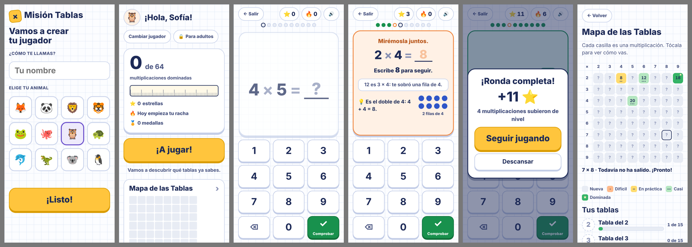

# Misión Tablas

Práctica de las tablas de multiplicar del 2 al 9 para niños de 9 años. La app descubre en qué multiplicaciones falla cada niño, se las repite hasta que las domina y las intercala con las que ya sabe. Las preguntas nunca se acaban.

**Para jugar:** https://hernandoarteaga.github.io/mision-tablas/



## Cómo se juega

- Cada niño crea su jugador con su nombre y un animal. Varios hermanos pueden compartir el mismo dispositivo.
- La pregunta aparece en grande y se responde con el teclado de la pantalla o con el del computador.
- Si se equivoca, la app le muestra la respuesta con un dibujo de puntos y un truco, y el niño la escribe para seguir.
- Cada 10 preguntas hay un resumen con las estrellas ganadas y las multiplicaciones que mejoró. A los 15 minutos sugiere una pausa, sin obligar.
- El Mapa de las Tablas muestra cómo va cada multiplicación. Al dominar una tabla gana su medalla y al dominarlas todas, un diploma.

## Cómo decide qué preguntar

1. Cada multiplicación tiene un nivel: Nueva, Difícil, En práctica, Casi o Dominada. Sube con aciertos y vuelve a Difícil con un error.
2. Lo que falla vuelve a salir tras 3 preguntas y otra vez unas 8 después, siempre con una pista visual.
3. Mezcla retos, repasos de lo ya dominado y algunas nuevas. Si el niño viene fallando pone más fáciles; si acierta todo, más retos.
4. Solo cuenta como Dominada si la responde bien y en menos de 4 segundos. El niño nunca ve un reloj. Las dominadas vuelven cada vez más espaciadas para no olvidarlas.
5. No mete nuevas mientras haya 4 difíciles, y si falla 3 veces la misma, le muestra la pista antes de preguntarla y la espacia más para no frustrarlo.

## Principios pedagógicos

- **Recordar, no reconocer:** el niño siempre escribe la respuesta. No hay opción múltiple.
- **Repetición espaciada e intercalada:** se mezclan tablas y dificultades; nunca bloques de una sola tabla.
- **Éxito alto con reto real:** la mezcla se ajusta para que acierte cerca del 80 %.
- **Rapidez medida en silencio:** sin cronómetro ni cuenta regresiva, para no generar ansiedad.
- **El error enseña:** sin vidas, sin "game over" y sin sonidos de castigo. Se elogia el esfuerzo y la mejora.
- **Comprensión además de memoria:** las pistas usan la propiedad conmutativa, dobles, ×10 menos un grupo y arreglos de puntos, y explican confusiones típicas (sumar en vez de multiplicar, correrse un grupo, cifras al revés).

## Para adultos

El botón **Para adultos** está protegido con una multiplicación de dos cifras y abre un panel con:

- mapa de calor de aciertos y tiempos por multiplicación;
- las 10 mayores falencias, con sus confusiones frecuentes ("7 × 8: respondió 54, tres veces");
- progreso por tabla;
- ajustes: umbral de rapidez, preguntas por ronda, tablas activas, incluir ×1 y sonido;
- copia de seguridad para pasar el progreso a otro dispositivo.

## Privacidad

No hay cuentas, servidor ni anuncios, y la app no recolecta datos. El progreso se guarda solo en el navegador del dispositivo donde se juega.

## Para desarrolladores

| Archivo | Qué contiene |
|---|---|
| `engine.js` | Motor adaptativo: niveles, reintentos, mezcla de preguntas, pistas y confusiones. Lógica pura, sin interfaz. |
| `template.html` | Interfaz: HTML, CSS y JavaScript. |
| `build.js` | Une el motor y la interfaz en `index.html`. |
| `index.html` | La app completa en un solo archivo. Es lo que publica GitHub Pages. |
| `sim.js` | Simula niños ficticios y verifica el motor. |
| `uitest.py` | Prueba la interfaz en Chromium: celular, tablet y solo teclado. |

Después de cambiar `engine.js` o `template.html`:

```bash
node build.js       # regenera index.html
node sim.js         # verifica el motor con niños simulados
python3 uitest.py   # verifica la interfaz (requiere playwright y pillow)
```

Las constantes ajustables del motor (umbral de rapidez, mezcla de preguntas, espaciado de reintentos) están al inicio de `engine.js`.
